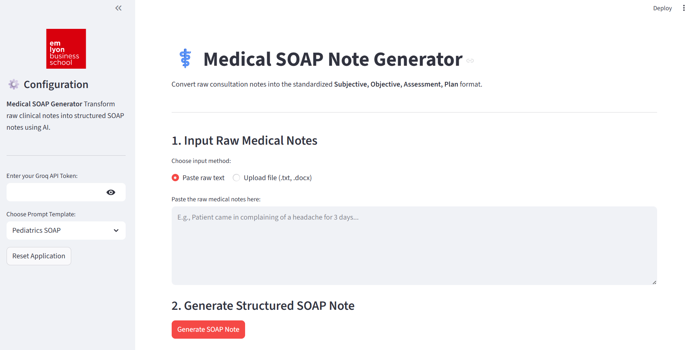

# Medical SOAP Note Generator

The **Medical SOAP Note Generator** is an AI-powered clinical tool built with Streamlit. It transforms unstructured medical consultation notes into standardized **SOAP** (Subjective, Objective, Assessment, and Plan) notes. By leveraging the Groq API and the `llama-3.3-70b-versatile` model, the application ensures high-quality, specialty-specific medical documentation.




---

## 🚀 Key Features

* **Diverse Specialty Support**: Includes tailored prompt templates for **Orthopedics**, **Pediatrics**, **Psychiatry**, and **Standard** medical use cases.

* **Flexible Data Input**: Support for pasting raw text or uploading clinical documents in `.txt` and `.docx` formats.
 
* **Intelligent Parsing**: AI logic specifically extracts vitals, mechanisms of injury, and mental status exam findings based on the selected specialty.

* **Streaming UI**: Real-time text generation allows providers to see the structured note as it is being composed.

* **Professional Export**: Direct-to-file downloads for both plain text and Microsoft Word formats.

---

## 📂 Project Structure

```text
soap_chat/
├── app.py                # Streamlit interface and AI orchestration [cite: 1]
├── main.py               # Application entry point [cite: 1]
├── prompts/              # Specialty-specific system prompts [cite: 1]
│   ├── Orthopedics_SOAP.txt
│   ├── Pediatrics_SOAP.txt
│   ├── Psychiatry_SOAP.txt
│   └── Standard_SOAP.txt
├── example_notes/        # Sample clinical notes for testing [cite: 1]
├── pyproject.toml        # UV-compatible project configuration [cite: 1]
└── uv.lock               # UV dependency lockfile [cite: 1]

```

---

## 🛠️ Installation & Setup

This project uses **uv** for fast, reliable Python package management.

### Prerequisites

* Python 3.12 or higher.
* A Groq API Key (entered within the application sidebar). You can go to this link to get one (free): https://console.groq.com/keys

### Quick Start

1. **Clone the repository**:
```bash
git clone <repository-url>
cd soap_chat
```

2. **Install dependencies and create virtual environment**:
```bash
uv sync
```

3. **Run the application**:
```bash
uv run streamlit run app.py
```

---

## 💡 How to Use

1. **Configuration**: Enter your Groq API Token in the sidebar.
2. **Specialty Selection**: Choose a template (e.g., *Psychiatry*) to apply specific formatting rules, such as Mental Status Exam structure.


3. **Note Entry**:

    * **Paste** your raw clinical observations.
    * **Upload** a `.docx` or `.txt` file containing the patient encounter details.

4. **Generation**: Click **"Generate SOAP Note"**. The AI will stream the structured content under Subjective, Objective, Assessment, and Plan headers.

5. **Review & Export**: Once satisfied, download the structured note as a `.docx` file for integration into an EMR or EHR system.

---

## ⚙️ Development

The application is designed to be extensible. To add a new medical specialty:

1. Create a new `.txt` file in the `prompts/` directory.

2. Define the required structure (Subjective, Objective, Assessment, Plan) within that file.

3. The application will automatically detect and list the new specialty in the UI dropdown.
